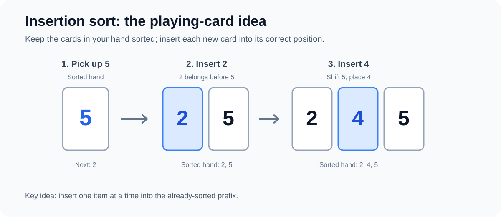
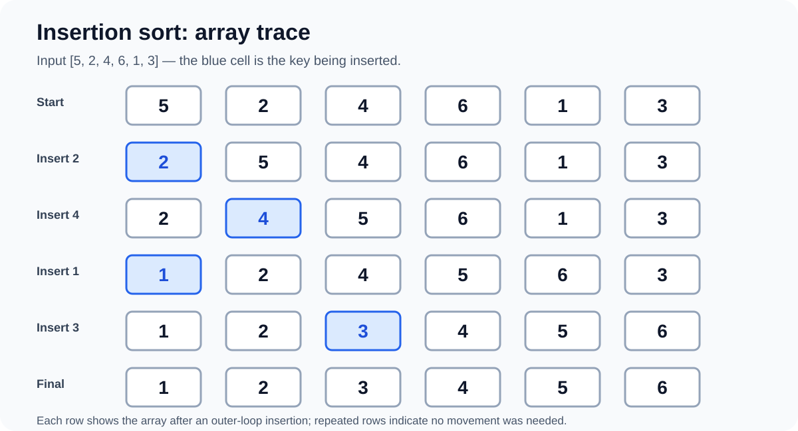
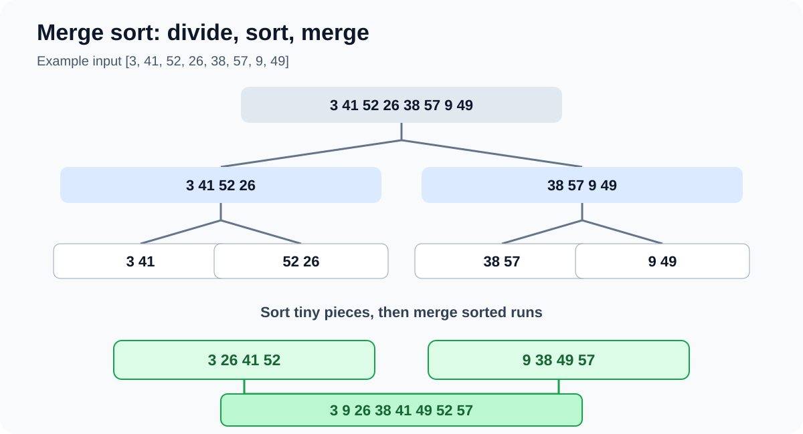

# Chapter 2 — Getting Started

**Reference:** CLRS, *Introduction to Algorithms*, Fourth Edition (2022), Chapter 2.  
**Implementation language:** Python.  
**Scope:** Sections 2.1–2.3, exercises, and chapter problems. These are original study explanations, not a reproduction of the textbook or an official solutions manual.

## Learning objectives

- Explain insertion sort and prove its correctness using a loop invariant.
- Understand the pseudocode conventions used throughout CLRS.
- Analyze algorithms under the RAM model.
- Derive best-case, average-case, and worst-case running times.
- Explain order of growth.
- Apply divide and conquer to merge sort.
- Derive and intuitively solve the merge-sort recurrence.

---

## 2.1 Insertion sort

### Sorting problem, keys, and records

Sorting takes a sequence of (n) numbers and returns a permutation of that sequence in nondecreasing order. The values being sorted are called **keys**. In applications, keys often belong to records containing additional **satellite data**. Sorting records by a key must move the associated data with it.

Example: sorting student records by GPA must preserve each student's name, age, and course information.

### The playing-card model

The hand represents the sorted prefix, and each new card is the key to insert. Compare from right to left, shift larger cards one position, and place the key in the gap.



### Incremental method

Insertion sort maintains a sorted prefix. It takes the next element and inserts it into the correct position in that prefix. The playing-card analogy is useful: keep the cards in one hand sorted while inserting each newly picked-up card.

CLRS pseudocode (1-based indexing):

```text
INSERTION-SORT(A, n)
1  for i = 2 to n
2      key = A[i]
3      // Insert A[i] into the sorted subarray A[1 : i - 1].
4      j = i - 1
5      while j > 0 and A[j] > key
6          A[j + 1] = A[j]
7          j = j - 1
8      A[j + 1] = key
```

The saved `key` is essential: shifting elements right could otherwise overwrite the value being inserted. The loop scans the sorted prefix from right to left. The `j > 0` condition prevents an invalid 1-based array access.

### Example

The highlighted cell is the key being inserted in that pass.



Starting with `[5, 2, 4, 6, 1, 3]`:

| Inserted key | Array after insertion |
|---:|---|
| 2 | 2, 5, 4, 6, 1, 3 |
| 4 | 2, 4, 5, 6, 1, 3 |
| 6 | 2, 4, 5, 6, 1, 3 |
| 1 | 1, 2, 4, 5, 6, 3 |
| 3 | 1, 2, 3, 4, 5, 6 |

### Loop invariant and correctness

At the beginning of each outer-loop iteration, (A[1:i-1]) contains exactly the elements originally in those positions, but in sorted order.

A loop-invariant proof has three parts:

1. **Initialization:** Before the first iteration, (i=2). The prefix (A[1:1]) has one element, so it is sorted and contains the original element.
2. **Maintenance:** The body shifts all prefix elements larger than the key rightward and inserts the key in its correct position. Thus (A[1:i]) contains the original elements from that range in sorted order. Incrementing (i) establishes the invariant for the next iteration.
3. **Termination:** The loop ends when (i=n+1). The invariant then says (A[1:n]) contains all original elements in sorted order.

A loop-invariant proof is a form of mathematical induction: initialization is the base case and maintenance is the inductive step. Termination connects the invariant to correctness.

### Python translation

Python uses 0-based indexing, so the first loop index is 1 and the inner guard is `j >= 0`.

```python
def insertion_sort(arr):
    for i in range(1, len(arr)):
        key = arr[i]
        j = i - 1

        while j >= 0 and arr[j] > key:
            arr[j + 1] = arr[j]
            j -= 1

        arr[j + 1] = key

    return arr
```

### Pseudocode conventions

- Indentation specifies blocks.
- `for`, `while`, `repeat-until`, and `if-else` have familiar meanings.
- In CLRS pseudocode, a loop counter retains the first value that exceeds the bound after a `for` loop. This matters in the insertion-sort termination proof; Python's loop variable retains its final iterated value.
- `else` aligns with its matching `if`; `elseif` represents another test in a multiway conditional.
- Procedure parameters are passed by value. For arrays and objects, the copied parameter is a reference to the same underlying object, so element or attribute mutation is visible to the caller.
- `to` increments a loop counter; `downto` decrements it; `by` specifies a different step.
- `//` begins a comment.
- Variables are local to a procedure unless stated otherwise.
- `A[i]` accesses an array element.
- `A[i:j]` denotes a subarray including both endpoints. This differs from Python slicing, whose upper bound is excluded.
- Object attributes use dot notation, such as `x.f`.
- `NIL` denotes a pointer that refers to no object.
- Parameters are passed by value; for arrays and objects, the copied parameter is a pointer to the same underlying object.
- Boolean `and` and `or` are short-circuiting.
- `return` transfers control to the caller; pseudocode may return multiple values.
- `error` indicates invalid calling conditions.

### Section 2.1 exercise takeaways

- **2.1-1:** Insertion sort on `[31, 41, 59, 26, 41, 58]` yields `[26, 31, 41, 41, 58, 59]`.
- **2.1-2:** For SUM-ARRAY, an invariant is that at the start of iteration (i), `sum` equals the sum of (A[1:i-1]). Initialization, maintenance, and termination establish the result.
- **2.1-3:** For decreasing order, change the inner comparison from `A[j] > key` to `A[j] < key`.
- **2.1-4:** Linear search scans from the beginning and returns a matching index or NIL. Invariant: the already-scanned prefix contains no occurrence of the target.
- **2.1-5:** Binary addition stores bits least-significant first. For each position, compute `total = A[i] + B[i] + carry`, write `total % 2`, and set `carry = total // 2`. Store the final carry in the extra output position.

---

## 2.2 Analyzing algorithms

### Why analyze?

A single timing run depends on the machine, language, implementation, input, compiler/interpreter, libraries, and background activity. Analysis predicts resource requirements from the algorithm rather than relying on one measurement.

### RAM model

CLRS primarily assumes a one-processor random-access machine (RAM):

- Instructions execute sequentially, without concurrent operations.
- Each instruction and data access takes constant time.
- Arithmetic, data movement, and control operations resemble those on real computers.
- Array indexing takes constant time under the model.

The RAM model does not explicitly represent caches or virtual memory. It is a useful abstraction, not a perfect model of every machine-level effect. The model should not assume unrealistic instructions such as a single primitive operation that sorts an arbitrary array.

### Input size

The right measure depends on the problem:

- Sorting: number of elements.
- Integer multiplication: number of bits used to represent the integers.
- Graph problems: often both vertices (V) and edges (E).

Running time is commonly written (T(n)), where (n) is the selected input-size measure.

### Counting statement costs

Assign a constant (c_k) to each execution of pseudocode line (k). If that line executes (m) times, it contributes (c_km) to the total. Comments contribute zero.

For insertion sort, let (t_i) be the number of evaluations of the inner while condition for outer-loop value (i). The condition is tested one more time than the body executes.

```text
Line 1: c1, executed n times
Line 2: c2, executed n - 1 times
Line 4: c4, executed n - 1 times
Line 5: c5, executed sum(t_i), i = 2..n
Line 6: c6, executed sum(t_i - 1), i = 2..n
Line 7: c7, executed sum(t_i - 1), i = 2..n
Line 8: c8, executed n - 1 times
```

Thus:

\[
T(n)=c_1n+c_2(n-1)+c_4(n-1)+c_5sum_{i=2}^{n}t_i
+c_6sum_{i=2}^{n}(t_i-1)+c_7sum_{i=2}^{n}(t_i-1)+c_8(n-1).
\]

### Best case

When the input is already sorted, the inner condition is tested once for every (i), so (t_i=1). The inner body never executes. The resulting running time is a linear function:

\[
T(n)=an+b=Theta(n).
\]

### Worst case

When the input is reverse sorted, (t_i=i). Use:

\[
sum_{i=2}^{n}i=\fracrac{n(n+1)}2-1
\]

and

\[
sum_{i=2}^{n}(i-1)=\fracrac{n(n-1)}2.
\]

The resulting running time is quadratic:

\[
T(n)=an^2+bn+c=Theta(n^2).
\]

### Worst-case and average-case analysis

CLRS usually focuses on worst-case running time because it gives an upper bound for every input of a given size, worst cases may occur frequently in practice, and average-case analysis requires a meaningful input probability model.

For randomly ordered insertion-sort inputs, the expected number of comparisons for each insertion is proportional to half the already-sorted prefix. The total remains quadratic. Randomized algorithms can make their own random choices, enabling expected-time analysis.

### Order of growth

For large input sizes, the leading term dominates lower-order terms. For example:

\[
an^2+bn+c
\]

has order of growth (Theta(n^2)). CLRS introduces (Theta)-notation informally in this chapter and formalizes it in Chapter 3. Constants and lower-order terms can still matter for small inputs.

### Selection sort: loop invariant and termination

Selection sort repeatedly finds the minimum of the unsorted suffix and exchanges it with the first element of that suffix.

```text
SELECTION-SORT(A, n)
1  for i = 1 to n - 1
2      min_index = i
3      for j = i + 1 to n
4          if A[j] < A[min_index]
5              min_index = j
6      exchange A[i] with A[min_index]
```

**Outer-loop invariant:** At the start of iteration i, A[1:i-1] contains the i-1 smallest input elements in nondecreasing order. Initialization holds for the empty prefix. The inner scan finds the minimum of A[i:n], and the exchange extends the prefix by one. When the loop finishes, the first n-1 positions contain the n-1 smallest values in order; the remaining element must be the largest, so a final pass is unnecessary.

### Section 2.2 exercise takeaways

- **2.2-1:** (n^3/1000+100n^2-100n+3=Theta(n^3)).
- **2.2-2:** Selection sort repeatedly selects the minimum remaining item. It makes ((n-1)+(n-2)+cdots+1=n(n-1)/2) comparisons, so best and worst cases are both (Theta(n^2)).
- **2.2-3:** If a successful linear-search target is equally likely to be at any position, the average number of checks is ((n+1)/2). Worst case is (n). Both are (Theta(n)).
- **2.2-4:** Add a preliminary check for an already-sorted input; if true, return immediately. The check takes linear time.

---

## 2.3 Designing algorithms

### Incremental method and divide and conquer

Insertion sort uses the incremental method: extend a solution to a smaller prefix. Divide and conquer is another design method with three steps:

1. **Divide:** break a problem into smaller instances of the same problem.
2. **Conquer:** solve the smaller instances recursively.
3. **Combine:** assemble their solutions into a solution to the original problem.

A base case is solved directly without further recursion.

### Merge sort

Merge sort divides a subarray (A[p:r]) at midpoint (q), recursively sorts (A[p:q]) and (A[q+1:r]), and merges the two sorted halves.

A one-element subarray ((p=r)) is the base case.



### Merge operation

The textbook's MERGE procedure can be understood in four phases: compute the lengths; copy the sorted halves into temporary arrays; repeatedly compare and copy the smallest unmerged item; then copy the remaining suffix of the nonempty temporary array. The textbook version uses temporary arrays indexed from zero, while the destination array uses the chapter's 1-based indexing.

The merge procedure copies the two already-sorted adjacent subarrays into temporary arrays (L) and (R). It repeatedly compares the smallest unmerged values and writes the smaller value into the destination array. When one temporary array is exhausted, the remaining values in the other are copied to the end.

The main indexes are:

- (i): next unmerged element in (L).
- (j): next unmerged element in (R).
- (k): next destination position in (A).

When keys are equal, taking the left value first preserves stability. Each element is copied back exactly once, so merging (n) total elements takes (Theta(n)) time.


### MERGE pseudocode (complete operational version)

The following is a 0-based temporary-array translation of the book's MERGE procedure. The destination subarray uses the original array's indices.

```text
MERGE(A, p, q, r)
1  nL = q - p + 1
2  nR = r - q
3  create L[0:nL-1] and R[0:nR-1]
4  for i = 0 to nL - 1
5      L[i] = A[p + i]
6  for j = 0 to nR - 1
7      R[j] = A[q + j + 1]
8  i = 0
9  j = 0
10 k = p
11 while i < nL and j < nR
12     if L[i] <= R[j]
13         A[k] = L[i]
14         i = i + 1
15     else
16         A[k] = R[j]
17         j = j + 1
18     k = k + 1
19 while i < nL
20     A[k] = L[i]
21     i = i + 1
22     k = k + 1
23 while j < nR
24     A[k] = R[j]
25     j = j + 1
26     k = k + 1
```

The temporary arrays contain the original two sorted ranges, so writing into A cannot destroy an unmerged value. The comparison uses `<=`, taking from L first when keys are equal; this preserves the relative order of equal keys. Each item is copied to a temporary array once and back to A once, so total work is proportional to (n=r-p+1).


### MERGE-SORT pseudocode

```text
MERGE-SORT(A, p, r)
1  if p >= r
2      return
3  q = floor((p + r) / 2)
4  MERGE-SORT(A, p, q)
5  MERGE-SORT(A, q + 1, r)
6  MERGE(A, p, q, r)
```

Python translation:

```python
def merge(arr, left, mid, right):
    L = arr[left:mid + 1]
    R = arr[mid + 1:right + 1]
    i = j = 0
    k = left

    while i < len(L) and j < len(R):
        if L[i] <= R[j]:
            arr[k] = L[i]
            i += 1
        else:
            arr[k] = R[j]
            j += 1
        k += 1

    while i < len(L):
        arr[k] = L[i]
        i += 1
        k += 1

    while j < len(R):
        arr[k] = R[j]
        j += 1
        k += 1


def merge_sort(arr, left=0, right=None):
    if right is None:
        right = len(arr) - 1
    if left >= right:
        return

    mid = (left + right) // 2
    merge_sort(arr, left, mid)
    merge_sort(arr, mid + 1, right)
    merge(arr, left, mid, right)
```

This uses temporary lists for merging, like the textbook's auxiliary arrays. It is not an in-place merge.

### General divide-and-conquer recurrence

If a problem creates (a) subproblems, each of size (n/b), and division and combination cost (D(n)) and (C(n)), respectively, then:

\[
T(n)=
\boxedegin{cases}
Theta(1),&n<n_0,\
aT(n/b)+D(n)+C(n),&	ext{otherwise}.
end{cases}
\]

Floors and ceilings may be omitted when they do not affect the order of growth. The base case is often omitted in abbreviated recurrence notation when it is understood to be constant time.

### Merge-sort recurrence

- Divide: midpoint calculation costs (Theta(1)).
- Conquer: two subproblems of approximately (n/2), costing (2T(n/2)).
- Combine: merge costs (Theta(n)).

Therefore:

\[
T(n)=2T(n/2)+Theta(n)
\]

The master theorem, developed in Chapter 4, gives:

\[
\boxedoxed{T(n)=Theta(nlg n)}
\]

### Recursion-tree intuition

For (n) an exact power of 2, use:

\[
T(n)=
\boxedegin{cases}
c_1,&n=1,\
2T(n/2)+c_2n,&n>1.
end{cases}
\]

At level (i), there are (2^i) nodes. Each node contributes (c_2(n/2^i)), so the total cost at every non-leaf level is:

\[
2^icdot c_2\fracrac{n}{2^i}=c_2n.
\]

There are (lg n) non-leaf levels. The leaf level has (n) leaves, each costing (c_1). Thus:

\[
T(n)=c_2nlg n+c_1n=Theta(nlg n).
\]

### Insertion sort versus merge sort

| Property | Insertion sort | Merge sort |
|---|---|---|
| Design | Incremental | Divide and conquer |
| Best-case time | (Theta(n)) | (Theta(nlg n)) |
| Worst-case time | (Theta(n^2)) | (Theta(nlg n)) |
| Auxiliary storage | (Theta(1)) | (Theta(n)) for the standard array merge |
| Stability | Yes, with the given strict comparison | Yes, when equal keys are taken from the left first |

---

## Complete worked solutions

The detailed step-by-step solutions for every exercise 2.1-1 through 2.3-8 and Problems 2-1 through 2-4 are in [Exercises and Problems](Exercises-and-Problems.md).

## Exercises 2.3 — Study responses

- **2.3-1:** Sorting ([3,41,52,26,38,57,9,49]) by merge sort produces ([3,9,26,38,41,49,52,57]).
- **2.3-2:** If the initial call has (nge1), every recursive split of a nonempty interval with (p<r) yields two nonempty intervals. Therefore, no recursive call has (p>r), and testing (p
e r) is sufficient under that condition.
- **2.3-3:** A merge-loop invariant is that the output prefix contains the smallest elements from the two temporary arrays, in sorted order. Each iteration copies the smaller front element. When one array is exhausted, the other remaining suffix is already sorted and can be copied.
- **2.3-4:** For (T(2)=2) and (T(n)=2T(n/2)+n), induction gives (T(n)=nlg n) for powers of 2. Base case: (2=2lg2). Inductive step: (2(n/2)lg(n/2)+n=nlg n).
- **2.3-5:** Recursive insertion sort first sorts the prefix of length (n-1), then inserts the final element. Its worst-case recurrence is (T(n)=T(n-1)+Theta(n)), giving (Theta(n^2)).
- **2.3-6:** Binary search repeatedly compares the midpoint of a sorted interval with the target and discards half the remaining interval. Its worst-case time is (Theta(lg n)).
- **2.3-7:** Binary search reduces comparisons but does not eliminate insertion sort's worst-case element shifts. The total remains (Theta(n^2)).
- **2.3-8:** Sort the integers, then use two pointers at opposite ends. Move the left pointer right if the sum is too small, or the right pointer left if too large. Sorting costs (Theta(nlg n)), and the scan costs (Theta(n)), for total (Theta(nlg n)).

## Problems for Chapter 2 — solution outlines

### 2-1 Insertion sort on small arrays in merge sort

Split the input into (n/k) sublists of length (k), sort each by insertion sort, then merge.

- (a) Each group costs (Theta(k^2)); there are (n/k) groups. Total: (Theta(nk)).
- (b) Merging takes (Theta(n)) per level, with approximately (lg(n/k)) levels. Total: (Theta(nlg(n/k))).
- (c) The total is (Theta(nk+nlg(n/k))). To retain (Theta(nlg n)), require (k=O(lg n)); the largest asymptotic order is (k=Theta(lg n)).
- (d) Benchmark candidate thresholds on the target implementation and workload; asymptotic analysis alone does not determine the best numeric cutoff.

### 2-2 Correctness of bubblesort

The algorithm repeatedly swaps adjacent out-of-order values.

- (a) Sortedness alone is insufficient: also prove the output is a permutation of the input. Termination follows from the finite loop bounds.
- (b) Inner-loop invariant: at the beginning of an iteration with index (j), the value at (A[j]) is the smallest value in the suffix (A[j:n]). Moving left carries that minimum toward position (i).
- (c) Outer-loop invariant: at the beginning of iteration (i), (A[1:i-1]) contains the (i-1) smallest elements in sorted order. The inner loop places the next smallest at (A[i]).
- (d) The comparison count is ((n-1)+(n-2)+cdots+1=Theta(n^2)), the same worst-case order as insertion sort.

### 2-3 Correctness of Horner's rule

For (P(x)=sum_{k=0}^{n}a_kx^k), Horner's form is:

\[
a_0+x(a_1+x(a_2+cdots+x(a_{n-1}+xa_n))).
\]

The procedure executes (n+1) constant-work iterations, so it takes (Theta(n)) time. A naive method that recomputes powers by repeated multiplication takes (Theta(n^2)) arithmetic operations.

The loop invariant supplied in the problem states that at the start of iteration (i):

\[
p=sum_{k=0}^{n-(i+1)}A[k+i+1]x^k.
\]

Initially the sum is empty and (p=0). The update (p=A[i]+xp) incorporates the next coefficient. At termination it yields (p=sum_{k=0}^{n}A[k]x^k).

### 2-4 Inversions

An inversion is a pair of positions ((i,j)) with (i<j) and (A[i]>A[j]).

- (a) For ([2,3,8,6,1]), the inversions by **positions** are ((1,5),(2,5),(3,4),(3,5),(4,5)). By values, they are ((2,1),(3,1),(8,6),(8,1),(6,1)).
- (b) A reverse-sorted array has the maximum number of inversions: (n(n-1)/2).
- (c) Each shift in insertion sort moves a larger element past a smaller key, eliminating one inversion. The number of shifts is the input's inversion count.
- (d) Modify merge sort to count cross-inversions during merging. When a right-side element is copied before the current left-side element, it is smaller than all remaining left-side elements; add the number of remaining left elements. The recurrence remains (T(n)=2T(n/2)+Theta(n)), so the algorithm takes (Theta(nlg n)).

---

## Chapter 2 revision sheet

1. Insertion sort maintains a sorted prefix and inserts one new key at a time.
2. Loop-invariant proofs require initialization, maintenance, and termination.
3. CLRS pseudocode usually uses 1-based array indexing; Python uses 0-based indexing.
4. The RAM model assumes constant-time primitive instructions and data accesses.
5. Input size must be selected to suit the problem.
6. Insertion sort has best-case (Theta(n)) and worst-case (Theta(n^2)) time.
7. Worst-case analysis provides an upper bound for all inputs of a given size.
8. Order of growth focuses on the leading term for sufficiently large inputs.
9. Divide and conquer consists of divide, conquer, and combine.
10. Merging two sorted subarrays takes (Theta(n)) time.
11. Merge sort satisfies (T(n)=2T(n/2)+Theta(n)).
12. Merge sort runs in (Theta(nlg n)) time.
13. Binary search requires sorted input and runs in (Theta(lg n)) time.
14. Reducing comparisons does not necessarily reduce data movement.
15. Inversions measure how far an array is from sorted order and can be counted using a merge-sort modification.

## Self-assessment

- [ ] Explain insertion sort without looking at pseudocode.
- [ ] Prove insertion sort correct using all three loop-invariant properties.
- [ ] Translate 1-based pseudocode into Python.
- [ ] Derive insertion sort's statement-count expression.
- [ ] Explain why the worst case is reverse sorted.
- [ ] Explain the RAM model and its limitations.
- [ ] Write selection sort and binary search.
- [ ] Implement merge and merge sort.
- [ ] Derive the merge-sort recurrence.
- [ ] Explain the recursion-tree level costs.
- [ ] Explain why binary insertion search does not make insertion sort (Theta(nlg n)).
- [ ] Explain how merge sort can count inversions.

**Status:** Chapter 2 notes drafted. Review the source chapter and solve the exercises independently before marking the chapter mastered.


## Visual guide index

| Illustration | What to study |
|---|---|
| [Playing-card insertion sort](images/insertion-sort-playing-cards.svg) | The sorted-hand analogy and insertion of one key |
| [Insertion-sort array trace](images/insertion-sort-array-trace.svg) | The changing prefix on the example array |
| [Merge-sort recursion](images/merge-sort-recursion.svg) | Divide into subarrays, sort, then combine |

## Chapter 2 Python implementations

- [Insertion sort](../../Implementations/Python/insertion_sort.py)
- [Merge sort](../../Implementations/Python/merge_sort.py)
- [Unit tests](../../Implementations/Python/test_sorting.py)
