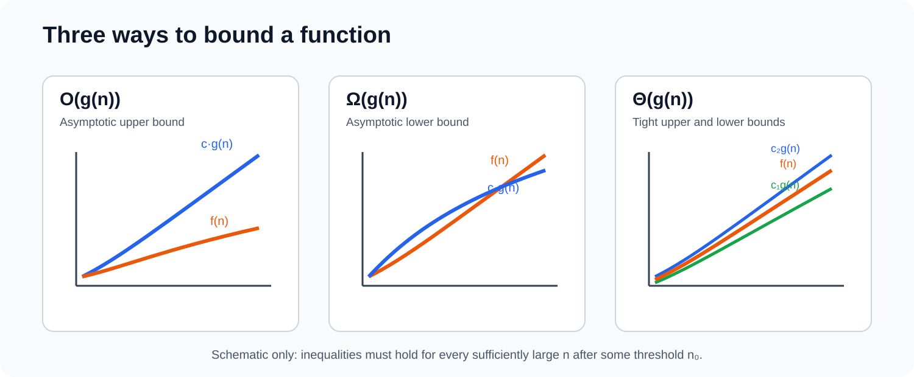

# Chapter 3 — Characterizing Running Times

**Reference:** CLRS, *Introduction to Algorithms*, Fourth Edition (2022), Chapter 3.  
**Purpose:** Learn to describe and compare the growth of functions precisely, reason about algorithm running times, and recognize the mathematical functions that commonly appear in algorithm analysis.  
**Notation:** \(\lg n=\log_2 n\). All asymptotic functions are understood over sufficiently large inputs and are asymptotically nonnegative unless stated otherwise.

These are original study notes aligned to the source's organization, not a reproduction of the textbook.

## Learning objectives

By the end of this chapter, you should be able to:

- Explain why asymptotic analysis ignores constant factors and lower-order terms.
- Distinguish upper, lower, and tight asymptotic bounds.
- Prove bounds directly from their quantified definitions.
- Use \(O,\Omega,\Theta,o,\omega\) accurately, including the textbook's equality conventions.
- Apply transitivity, reflexivity, symmetry, and transpose symmetry.
- Work with floors, ceilings, modular arithmetic, polynomials, exponentials, logarithms, factorials, iterated logarithms, and Fibonacci numbers.
- Compare common growth rates and avoid unsupported comparisons.

---

## 3.1 O-notation, \(\Omega\)-notation, and \(\Theta\)-notation

### Why asymptotic notation?

An exact running-time expression can contain many statement costs, lower-order terms, and machine-dependent constants. For large inputs, the dominant growth term is usually the most useful basis for comparing algorithms.

For example, if
\[
T(n)=7n^3+100n^2-20n+6,
\]
then the cubic term dominates as \(n\) grows. The function has order \(\Theta(n^3)\). The coefficient 7 and the lower-order terms do not change that asymptotic order.

Asymptotic notation applies to functions generally, not only running times. It can describe memory use, communication, number of operations, or other quantities.

### O-notation: asymptotic upper bound

Informally, \(f(n)=O(g(n))\) means that \(f\) grows no faster than \(g\), up to a positive constant factor.

Formally,
\[
O(g(n))=\{f(n):\exists c>0,\ n_0>0,\ 0\le f(n)\le cg(n)\ \forall n\ge n_0\}.
\]

The constants \(c\) and \(n_0\) must be fixed, positive constants. The inequality must hold for every \(n\) from \(n_0\) onward.

**Example.** Show that \(4n^2+100n+500=O(n^2)\). For \(n\ge1\),
\[
4n^2+100n+500\le 4n^2+100n^2+500n^2=604n^2.
\]
Choose \(c=604\) and \(n_0=1\). This satisfies the definition.

The bound need not be tight: \(7n^3+100n^2-20n+6\) is also \(O(n^4)\), \(O(n^5)\), and so on. Prefer the most informative bound when one is available.

### \(\Omega\)-notation: asymptotic lower bound

Informally, \(f(n)=\Omega(g(n))\) means that \(f\) grows at least as fast as \(g\), up to a positive constant factor.

Formally,
\[
\Omega(g(n))=\{f(n):\exists c>0,\ n_0>0,\ 0\le cg(n)\le f(n)\ \forall n\ge n_0\}.
\]

**Example.** For \(f(n)=4n^2+100n+500\), all terms are nonnegative for \(n\ge1\), so \(f(n)\ge4n^2\). Choose \(c=4\), \(n_0=1\). Thus \(f(n)=\Omega(n^2)\).

A lower bound does not have to be tight either. A quadratic function is also \(\Omega(n)\).

### \(\Theta\)-notation: asymptotically tight bound

Informally, \(f(n)=\Theta(g(n))\) means that \(f\) is bounded both above and below by positive constant multiples of \(g\).

Formally,
\[
\Theta(g(n))=\{f(n):\exists c_1,c_2>0,\ n_0>0,\ 0\le c_1g(n)\le f(n)\le c_2g(n)\ \forall n\ge n_0\}.
\]

For asymptotically nonnegative functions,
\[
f(n)=\Theta(g(n))
\quad\Longleftrightarrow\quad
f(n)=O(g(n))\ \text{and}\ f(n)=\Omega(g(n)).
\]

This is Theorem 3.1 in the chapter.

### Insertion sort: upper and lower bounds

**Upper bound.** The outer loop executes \(n-1\) times. For each \(i\), the inner loop shifts at most \(i-1\) elements. Therefore its total iterations are at most
\[
\sum_{i=2}^{n}(i-1)=\frac{n(n-1)}2=O(n^2).
\]
The constant work outside the inner loop is \(O(n)\), so the whole algorithm is \(O(n^2)\) for every input.

**Worst-case lower bound.** Consider an input whose largest \(n/3\) values begin in the first \(n/3\) positions (take \(n\) divisible by 3 for this argument). Each of those values must move right through the middle \(n/3\) positions. Since insertion sort moves an element at most one position per shift, at least
\[
(n/3)(n/3)=n^2/9
\]
shifts are required. Thus some input of every such size requires \(\Omega(n^2)\) time. Together with the upper bound, the worst-case time is \(\Theta(n^2)\).

This does **not** mean every input takes \(\Theta(n^2)\): an already sorted input takes \(\Theta(n)\).

### A common precision rule

State which case a bound describes:

- Insertion sort worst case: \(\Theta(n^2)\).
- Insertion sort best case: \(\Theta(n)\).
- Insertion sort on an unspecified input: \(O(n^2)\) is a valid blanket upper bound, but \(\Theta(n^2)\) is not.
- Merge sort: \(\Theta(n\lg n)\) in all cases.

Do not say “at least \(O(n^2)\).” \(O\) is an upper bound; “at least” describes a lower bound, for which \(\Omega\) is the relevant notation.

### Asymptotic notation in equations

When asymptotic notation stands alone on the right-hand side, an expression such as
\[
4n^2+100n+500=O(n^2)
\]
uses equality as shorthand for set membership.

Inside a larger formula, asymptotic notation represents an anonymous function of the stated order. For example,
\[
2n^2+3n+1=2n^2+\Theta(n).
\]
The \(\Theta(n)\) term stands for some function in that set (here, \(3n+1\)).

When notation appears on the left side, interpret the equation so that every allowed choice of anonymous functions on the left can be matched by a suitable choice on the right. This convention lets us write compact bounds without naming irrelevant lower-order terms.

### Proper abuses and domain conventions

- The variable tending to infinity is inferred from context: \(O(g(n))\) concerns \(n\), while \(O(g(m))\) concerns \(m\).
- \(T(n)=O(1)\) for a stated finite base-case range is conventional shorthand for a constant bound on that range; the asymptotic definition itself concerns sufficiently large arguments.
- A recurrence may be defined only on a subset of input sizes (for example, powers of two). Its asymptotic bound is understood over its domain.
- These conventions simplify notation, but they do not permit changing an upper bound into a tight bound or ignoring the conditions of a definition.

---

## 3.2 Asymptotic notation: formal definitions

### Little-oh: \(o\)

Little-oh is a **strict** asymptotic upper bound:
\[
o(g(n))=\{f(n):\forall c>0,\ \exists n_0>0,\ 0\le f(n)<cg(n)\ \forall n\ge n_0\}.
\]

The quantifier order matters: the inequality must eventually hold for **every** positive \(c\), not merely one.

Intuitively, \(f\) becomes insignificant relative to \(g\):
\[
\lim_{n\to\infty}\frac{f(n)}{g(n)}=0
\]
when the limit formulation applies.

Examples:
- \(2n=o(n^2)\), because \(2n/n^2=2/n\to0\).
- \(2n^2\notin o(n^2)\), because the ratio is 2, not 0.
- \(n\lg n=o(n^{1+\epsilon})\) for every fixed \(\epsilon>0\).

### Little-omega: \(\omega\)

Little-omega is a **strict** asymptotic lower bound:
\[
\omega(g(n))=\{f(n):\forall c>0,\ \exists n_0>0,\ 0\le cg(n)<f(n)\ \forall n\ge n_0\}.
\]

Intuitively, \(f\) becomes arbitrarily large relative to \(g\):
\[
\lim_{n\to\infty}\frac{f(n)}{g(n)}=\infty
\]
when that limit exists.

Examples:
- \(n^2/2=\omega(n)\).
- \(n^2/2\notin\omega(n^2)\).

### Comparing the five notations

| Notation | Meaning | Quantifier on constant |
|---|---|---|
| \(O(g)\) | Upper bound | There exists \(c>0\) |
| \(\Omega(g)\) | Lower bound | There exists \(c>0\) |
| \(\Theta(g)\) | Tight upper and lower bounds | There exist \(c_1,c_2>0\) |
| \(o(g)\) | Strict upper bound | For every \(c>0\) |
| \(\omega(g)\) | Strict lower bound | For every \(c>0\) |

A useful memory aid: big notation allows a suitable constant factor; little notation must work against every positive constant factor.

### Comparing functions: algebraic properties

Assume the functions are asymptotically positive where required.

**Transitivity**
\[
\begin{aligned}
f=\Theta(g),\ g=\Theta(h)&\Rightarrow f=\Theta(h),\\
f=O(g),\ g=O(h)&\Rightarrow f=O(h),\\
f=\Omega(g),\ g=\Omega(h)&\Rightarrow f=\Omega(h),\\
f=o(g),\ g=o(h)&\Rightarrow f=o(h),\\
f=\omega(g),\ g=\omega(h)&\Rightarrow f=\omega(h).
\end{aligned}
\]

**Reflexivity**
\[
f=\Theta(f),\qquad f=O(f),\qquad f=\Omega(f).
\]

**Symmetry**
\[
f=\Theta(g)\Longleftrightarrow g=\Theta(f).
\]

**Transpose symmetry**
\[
f=O(g)\Longleftrightarrow g=\Omega(f),
\qquad
f=o(g)\Longleftrightarrow g=\omega(f).
\]

Analogy: \(O\) resembles \(\le\), \(\Omega\) resembles \(\ge\), \(\Theta\) resembles equality, \(o\) resembles \(<\), and \(\omega\) resembles \(>\).

### Trichotomy does not hold

For real numbers, exactly one of \(a<b\), \(a=b\), or \(a>b\) holds. Asymptotic functions do not have this property: some pairs are incomparable.

For example, \(f(n)=n\) and \(g(n)=n^{1+\sin n}\) oscillate in relative growth. Neither function is an asymptotic upper bound for the other over all sufficiently large integers. Therefore neither \(f=O(g)\) nor \(f=\Omega(g)\) need hold.

### Two independent parameters

For functions of \(n\) and \(m\), both parameters may grow independently. A textbook-style upper bound requires constants \(c,n_0,m_0>0\) such that
\[
0\le f(n,m)\le cg(n,m)
\]
whenever \(n\ge n_0\) **or** \(m\ge m_0\), with the precise domain condition interpreted as in the definition. For \(\Omega\), reverse the inequality; for \(\Theta\), require both bounds. When using two-parameter notation, state clearly which variables tend to infinity and under what joint condition.

---

## 3.3 Standard notations and common functions

### Monotonicity

For a function \(f\):

- Monotonically increasing: \(m\le n\Rightarrow f(m)\le f(n)\).
- Monotonically decreasing: \(m\le n\Rightarrow f(m)\ge f(n)\).
- Strictly increasing: \(m<n\Rightarrow f(m)<f(n)\).
- Strictly decreasing: \(m<n\Rightarrow f(m)>f(n)\).

“Monotone” permits equal values; “strictly” does not.

If \(f\) and \(g\) are increasing, then \(f+g\) is increasing and \(f(g(n))\) is increasing. If they are also nonnegative, their product is increasing.

### Floors and ceilings

For real \(x\):
- \(\lfloor x\rfloor\): greatest integer at most \(x\).
- \(\lceil x\rceil\): least integer at least \(x\).

Basic inequalities:
\[
x-1<\lfloor x\rfloor\le x\le\lceil x\rceil<x+1.
\]
For integer \(n\), \(\lfloor n\rfloor=\lceil n\rceil=n\).

Useful identities and bounds include:
\[
-\lfloor x\rfloor=\lceil-x\rceil,\qquad
-\lceil x\rceil=\lfloor-x\rfloor,
\]
\[
\left\lceil\frac{\lceil x/a\rceil}{b}\right\rceil
=\left\lceil\frac{x}{ab}\right\rceil
\quad (a,b\text{ positive integers}),
\]
and corresponding floor identity
\[
\left\lfloor\frac{\lfloor x/a\rfloor}{b}\right\rfloor
=\left\lfloor\frac{x}{ab}\right\rfloor.
\]
For positive integers \(a,b\) and real \(x\ge0\), the nested rounding identities are
\[
\left\lceil\frac{\lceil x/a\rceil}{b}\right\rceil=\left\lceil\frac{x}{ab}\right\rceil,
\qquad
\left\lfloor\frac{\lfloor x/a\rfloor}{b}\right\rfloor=\left\lfloor\frac{x}{ab}\right\rfloor.
\]
For integers \(a\) and positive integer \(b\),
\[
\left\lceil\frac ab\right\rceil\le\frac{a+b-1}{b},
\qquad
\left\lfloor\frac ab\right\rfloor\ge\frac{a-b+1}{b}.
\]
Also, for integer \(n\), \(\lfloor n+x\rfloor=n+\lfloor x\rfloor\) and \(\lceil n+x\rceil=n+\lceil x\rceil\).

Floors and ceilings often change a quantity by less than one. For asymptotic bounds on growing positive functions, such rounding usually does not change the order.

### Modular arithmetic

For integer \(a\) and positive integer \(n\),
\[
a\bmod n=a-n\lfloor a/n\rfloor.
\]
The remainder satisfies
\[
0\le a\bmod n<n,
\]
including when \(a\) is negative under this floor-based definition.

If \(a\bmod n=b\bmod n\), write
\[
a\equiv b\pmod n.
\]
Equivalently, \(n\) divides \(b-a\).

### Polynomials

A degree-\(d\) polynomial is
\[
p(n)=\sum_{i=0}^{d}a_i n^i,\qquad a_d\ne0.
\]
If \(a_d>0\), the polynomial is asymptotically positive and
\[
p(n)=\Theta(n^d).
\]
The leading term determines its asymptotic order. A function is polynomially bounded if it is \(O(n^k)\) for some constant \(k\).

### Exponentials

For \(a>0\), exponent rules include:
\[
a=b^{\log_b a}\quad(b>0,\ b\ne1),\qquad
a^0=1,\quad a^1=a,\quad a^{-1}=1/a,\quad
(a^m)^n=a^{mn},\quad a^ma^n=a^{m+n}.
\]

For \(a>1\), exponentials dominate every polynomial:
\[
n^b=o(a^n)
\]
for every real constant \(b\). One way to understand this is that the ratio \(n^b/a^n\) tends to zero.

The natural exponential has the series
\[
e^x=\sum_{i=0}^{\infty}\frac{x^i}{i!}
=1+x+\frac{x^2}{2!}+\cdots.
\]
Useful inequalities:
\[
1+x\le e^x\quad\text{for all real }x,
\]
with equality only at \(x=0\). For \(|x|\le1\),
\[
1+x\le e^x\le1+x+x^2.
\]
As \(x\to0\),
\[
e^x=1+x+\Theta(x^2).
\]
Also,
\[
\lim_{n\to\infty}\left(1+\frac{x}{n}\right)^n=e^x.
\]

### Logarithms

CLRS notation:
\[
\lg n=\log_2 n,\qquad \ln n=\log_e n,\qquad
\lg^k n=(\lg n)^k,\qquad
\lg\lg n=\lg(\lg n).
\]

Without parentheses, a logarithm applies only to the next term: \(\lg n+1\) means \((\lg n)+1\).

Key identities:
\[
\log_c(ab)=\log_c a+\log_c b,
\quad
\log_b(a^n)=n\log_b a,
\]
\[
\log_b a=\frac{\log_c a}{\log_c b},
\quad
\log_b(1/a)=-\log_b a,
\quad
\log_b a=\frac1{\log_a b},\qquad a^{\log_b c}=c^{\log_b a}.
\]
Changing between constant bases changes a logarithm by only a constant factor. Thus \(\log_b n=\Theta(\lg n)\) for fixed bases \(b>1\).

Polylogarithms grow more slowly than every positive polynomial:
\[
\lg^b n=o(n^a)
\]
for constants \(a>0\) and real \(b\).

### Factorials and Stirling's approximation

For integers \(n\ge0\):
\[
n!=
\begin{cases}
1,&n=0,\\
n(n-1)!,&n>0.
\end{cases}
\]
Thus \(n!=1\cdot2\cdots n\).

A simple upper bound is \(n!\le n^n\). Stirling's approximation gives a much tighter estimate:
\[
n!=\sqrt{2\pi n}\left(\frac ne\right)^n
\left(1+\Theta(1/n)\right).
\]
A refined version used in the chapter is
\[
n!=\sqrt{2\pi n}\left(\frac ne\right)^n e^{\alpha_n},
\qquad \frac{1}{12n+1}<\alpha_n<\frac{1}{12n}.
\]
Consequences:
\[
n!=o(n^n),\qquad n!=\omega(2^n),\qquad
\lg(n!)=\Theta(n\lg n).
\]

### Functional iteration and iterated logarithm

For a function \(f\), define repeated composition:
\[
f^{(0)}(n)=n,\qquad f^{(i)}(n)=f(f^{(i-1)}(n)).
\]
For \(f(n)=2n\), \(f^{(i)}(n)=2^i n\).

The iterated logarithm, \(\lg^*n\), is the minimum number of repeated base-2 logarithms needed to reduce \(n\) to at most 1:
\[
\lg^*n=\min\{i\ge0:\lg^{(i)}n\le1\}.
\]
Examples:
\[
\lg^*2=1,\quad \lg^*4=2,\quad
\lg^*16=3,\quad \lg^*65536=4.
\]
It grows extraordinarily slowly; values greater than 5 are not encountered for practical input sizes.

Distinguish \(\lg^{(i)}n\) (logarithm applied repeatedly) from \(\lg^i n=(\lg n)^i\) (a power of a logarithm).

### Fibonacci numbers and the golden ratio

The Fibonacci sequence is:
\[
F_0=0,\quad F_1=1,\quad F_i=F_{i-1}+F_{i-2}\quad(i\ge2).
\]
It begins \(0,1,1,2,3,5,8,13,\ldots\).

The golden ratio and its conjugate are roots of \(x^2=x+1\):
\[
\phi=\frac{1+\sqrt5}{2},\qquad
\hat\phi=\frac{1-\sqrt5}{2}.
\]
Binet's formula:
\[
F_i=\frac{\phi^i-\hat\phi^i}{\sqrt5}.
\]
Since \(|\hat\phi|<1\), its power tends to zero. Therefore
\[
F_i=\left\lfloor\frac{\phi^i}{\sqrt5}+\frac12\right\rfloor,
\]
so Fibonacci numbers grow exponentially: \(F_i=\Theta(\phi^i)\).

---

### Visual guide: upper, lower, and tight bounds

The picture is conceptual: the constants and threshold may differ between the three definitions. A valid proof must identify constants and a threshold that make the required inequalities hold for every sufficiently large input.

---

## Engineering perspective

When reading a performance claim, ask:

1. What is the input-size variable? Is it \(n\), the number of records, bits, vertices, edges, or something else?
2. Is the claim a worst-case, best-case, average-case, or all-input statement?
3. Is the notation an upper bound, lower bound, or tight bound?
4. Are the functions asymptotically positive, and what is their domain?
5. Are there multiple input parameters that grow independently?
6. Are logarithm bases fixed constants?
7. Are floors and ceilings relevant to correctness, or can they safely be suppressed for asymptotic analysis?
8. Does the mathematical bound describe the whole algorithm or only one operation?

**Example:** Saying “this endpoint is \(O(n^2)\)” gives only an upper bound. It does not establish that the endpoint actually takes quadratic time. If a benchmark or proof establishes matching upper and lower bounds, use \(\Theta(n^2)\).

## Chapter notes

The chapter's historical notes trace the use of \(O\)-notation to number theory in the late nineteenth century and the development of \(o\)-notation by Landau in 1909. Knuth advocated the use of \(\Omega\) and \(\Theta\) to distinguish lower and tight bounds from the often-misused \(O\)-notation. The chapter also notes that definitions can vary among authors, especially for functions that are not asymptotically nonnegative. Robbins is credited for the refined factorial estimate used in the chapter. These historical notes are context; the formal definitions used in this study guide are the definitions adopted by CLRS Fourth Edition.

## Chapter 3 revision sheet

- \(O\): asymptotic upper bound.
- \(\Omega\): asymptotic lower bound.
- \(\Theta\): tight bound, equivalent to both \(O\) and \(\Omega\).
- \(o\): strict upper bound; ratio tends to zero.
- \(\omega\): strict lower bound; ratio tends to infinity when the limit exists.
- Transitivity holds for all five notations.
- \(\Theta\) is symmetric; \(O\) and \(\Omega\) are transposes.
- Asymptotic comparisons do not obey trichotomy.
- Positive degree-\(d\) polynomial: \(\Theta(n^d)\).
- Exponential \(a^n\), \(a>1\), dominates every polynomial.
- Every positive polynomial dominates every polylogarithm.
- \(\lg(n!)=\Theta(n\lg n)\).
- \(\lg^*n\) grows extremely slowly.
- \(F_n=\Theta(\phi^n)\).

## Self-assessment

1. Give the quantified definition of \(O(g(n))\). Identify which constants may depend on the function.
2. Prove \(3n^2+10n+7=\Theta(n^2)\) by choosing explicit constants.
3. Explain why insertion sort is not \(\Theta(n^2)\) on every input.
4. Give an example of a strict little-oh relation and justify it with a limit.
5. State the difference between \(O(n^2)\) and \(\Theta(n^2)\).
6. Explain why asymptotic comparisons do not satisfy trichotomy.
7. Why does changing the base of a logarithm not affect its \(\Theta\)-class?
8. Explain the difference between \(\lg^*n\) and \((\lg n)^*\) (the latter is not the chapter's iterated-log notation).
9. State Stirling's approximation and one consequence.
10. Derive the exponential growth rate of Fibonacci numbers from Binet's formula.

## Coverage audit

- [x] Section 3.1: intuitive \(O,\Omega,\Theta\), insertion-sort upper/lower bounds, precision in algorithm claims
- [x] Section 3.2: formal definitions, little-oh, little-omega, comparison properties, non-trichotomy, two parameters
- [x] Section 3.3: monotonicity, floors/ceilings, modular arithmetic, polynomials, exponentials, logarithms, factorials, iteration, \(\lg^*n\), Fibonacci numbers
- [x] Exercises 3.1-1 through 3.3-9 — worked solutions in the companion file
- [x] Problems 3-1 through 3-7 — worked solutions in the companion file

**Status:** Chapter 3 notes drafted and cross-checked against the Chapter 3 source pages. Complete the exercise/problem companion review and final repository audit before marking the chapter complete.
