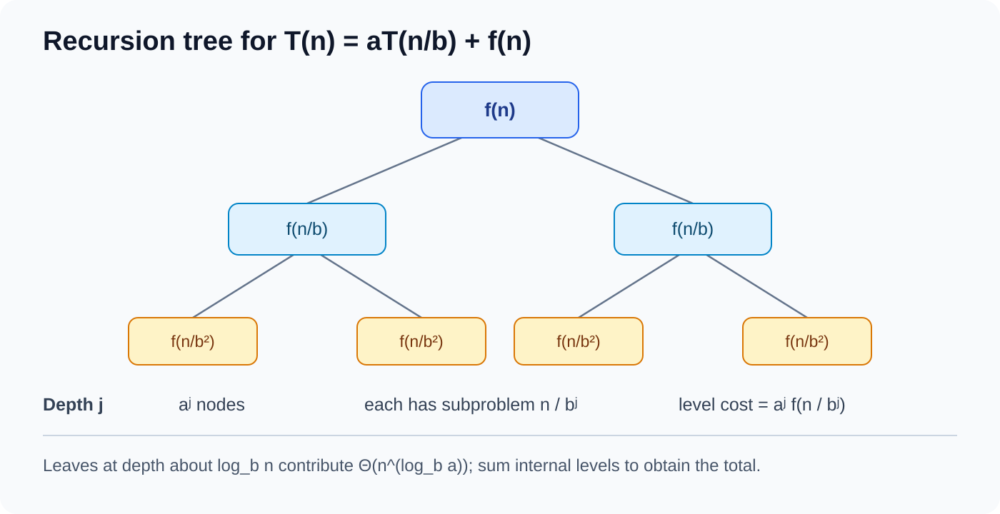

# Chapter 4 — Divide-and-Conquer

**Reference:** CLRS, *Introduction to Algorithms*, Fourth Edition (2022), Chapter 4.  
**Purpose:** Derive, solve, and reason about the recurrences produced by divide-and-conquer algorithms. These are original study notes, not a reproduction of the textbook.

## Learning objectives

- Formulate recurrences from recursive algorithms and identify base cases.
- Analyze standard and Strassen matrix multiplication.
- Prove recurrence bounds with substitution and recursion trees.
- Apply the master theorem, understand its limits, and use Akra–Bazzi for unequal subproblem sizes.
- Account for copying, parameter passing, floors, and ceilings.

## Recurrence foundations

A divide-and-conquer algorithm has three stages:

1. **Divide** a problem into smaller instances.
2. **Conquer** by solving those instances recursively.
3. **Combine** their solutions.

A recurrence expresses the running time in terms of smaller input sizes. A base case does not recurse; a recursive case does. A recurrence is well defined if at least one function satisfies it. An **algorithmic recurrence** has constant-order base cases below a threshold and every recursive path reaches a base case after finitely many calls.

CLRS convention: if an algorithmic recurrence is written without a base case, assume an implicit \(\Theta(1)\) base case below a suitable threshold. If a recurrence is an inequality, its solution normally gives a one-sided bound, not automatically a tight bound.

Floors and ceilings often arise because array sizes are integers. The master theorem allows them to be omitted for its class of equal-size recurrences. Akra–Bazzi requires a condition on the driving function before such rounding can be ignored.

---

## 4.1 Multiplying square matrices

For square \(n\times n\) matrices,
\[
C=AB,\qquad c_{ij}=\sum_{k=1}^{n}a_{ik}b_{kj}.
\]
There are \(n^2\) output entries and \(n\) terms per entry. The ordinary triple-loop algorithm takes
\[
\boxed{\Theta(n^3)}.
\]
The textbook procedure adds \(AB\) into an existing \(C\); initialize \(C=0\) to obtain just \(AB\). Initialization costs \(\Theta(n^2)\), which does not change the total.

### Eight-way recursive multiplication

Partition each matrix into four \((n/2)\times(n/2)\) blocks:
\[
A=\begin{bmatrix}A_{11}&A_{12}\\A_{21}&A_{22}\end{bmatrix},
\quad
B=\begin{bmatrix}B_{11}&B_{12}\\B_{21}&B_{22}\end{bmatrix}.
\]
Then
\[
\begin{aligned}
C_{11}&=A_{11}B_{11}+A_{12}B_{21},&
C_{12}&=A_{11}B_{12}+A_{12}B_{22},\\
C_{21}&=A_{21}B_{11}+A_{22}B_{21},&
C_{22}&=A_{21}B_{12}+A_{22}B_{22}.
\end{aligned}
\]
Eight recursive multiplications are needed. With index-based partitioning:
\[
T(n)=8T(n/2)+\Theta(1)=\boxed{\Theta(n^3)}.
\]
There are \(8^i\) nodes at depth \(i\), and \(8^{\lg n}=n^3\) leaves.

**Copying versus indexing:** copying all blocks costs \(\Theta(n^2)\) per call, giving \(8T(n/2)+\Theta(n^2)=\Theta(n^3)\) for multiplication. For other operations, copying may change the asymptotic result.

---

## 4.2 Strassen's algorithm

Strassen replaces eight half-size multiplications with seven, paying for a constant number of extra matrix additions/subtractions.

Form:
\[
\begin{array}{ll}
S_1=B_{12}-B_{22},&S_2=A_{11}+A_{12},\\
S_3=A_{21}+A_{22},&S_4=B_{21}-B_{11},\\
S_5=A_{11}+A_{22},&S_6=B_{11}+B_{22},\\
S_7=A_{12}-A_{22},&S_8=B_{21}+B_{22},\\
S_9=A_{11}-A_{21},&S_{10}=B_{11}+B_{12}.
\end{array}
\]
Compute:
\[
\begin{array}{ll}
P_1=A_{11}S_1,&P_2=S_2B_{22},\\
P_3=S_3B_{11},&P_4=A_{22}S_4,\\
P_5=S_5S_6,&P_6=S_7S_8,\\
P_7=S_9S_{10}.&
\end{array}
\]
Combine:
\[
\begin{aligned}
C_{11}&\mathrel{+}=P_5+P_4-P_2+P_6,\\
C_{12}&\mathrel{+}=P_1+P_2,\\
C_{21}&\mathrel{+}=P_3+P_4,\\
C_{22}&\mathrel{+}=P_5+P_1-P_3-P_7.
\end{aligned}
\]
Ten block additions/subtractions form the \(S_i\); twelve combine the \(P_i\) into \(C\). All nonrecursive work is \(\Theta(n^2)\):
\[
T(n)=7T(n/2)+\Theta(n^2)
=\boxed{\Theta(n^{\lg7})}\approx\Theta(n^{2.8074}).
\]
This is asymptotically faster than cubic multiplication, though constants and memory traffic matter in practice.

---

## 4.3 The substitution method

The substitution method is induction applied to a guessed bound.

1. Guess the asymptotic form (often using a recursion tree).
2. State an explicit inductive hypothesis with constants.
3. Prove base cases.
4. Substitute the hypothesis into the recurrence and prove the exact target inequality.

Do not use an expression such as \(T(n)\le O(n)\) as the inductive hypothesis: the hidden constant can change between steps. Write \(T(n)\le cn\) with a fixed \(c\).

### Strengthen a failed hypothesis

For \(T(n)=2T(n/2)+\Theta(1)\), guessing \(T(n)\le cn\) yields \(cn+\Theta(1)\), which does not close. Try \(T(n)\le cn-d\):
\[
2(cn/2-d)+\Theta(1)=cn-2d+\Theta(1)\le cn-d
\]
when \(d\) is chosen large enough. The lower-order subtraction gives the induction room it needs.

For \(T(n)=4T(n/2)+n\), a guess \(cn^2\) similarly fails by an additive \(n\); use \(cn^2-dn\).

---

## 4.4 The recursion-tree method

For \(T(n)=aT(n/b)+f(n)\), at depth \(j\):

- number of nodes: \(a^j\);
- subproblem size per node: \(n/b^j\);
- total level cost: \(a^j f(n/b^j)\).

Leaves occur at depth about \(\lg_b n\), and their total cost is \(\Theta(n^{\lg_b a})\).

Procedure:
1. Draw several levels.
2. Write one node's cost and the number of nodes.
3. Sum the cost at each level.
4. Find the height and leaf count.
5. Compare internal and leaf costs.
6. Verify the guess by substitution if the tree argument is approximate.

### Unequal subproblems

For \(T(n)=T(n/3)+T(2n/3)+\Theta(n)\), the tree is unbalanced. The longest paths have logarithmic length. Internal cost is \(O(n)\) per level, hence \(O(n\lg n)\). The number of leaves is \(\Theta(n)\), and \(\Theta(\lg n)\) levels have total subproblem size \(\Theta(n)\), giving a matching lower bound:
\[
T(n)=\Theta(n\lg n).
\]

---

## 4.5 The master method

For
\[
T(n)=aT(n/b)+f(n),\qquad a>0,\ b>1,
\]
call \(f(n)\) the driving function and define the watershed exponent \(p=\log_b a\).

**Case 1 — Leaves dominate.** If some \(\epsilon>0\) satisfies
\[
f(n)=O(n^{p-\epsilon}),
\]
then \(T(n)=\Theta(n^p)\).

**Case 2 — Levels contribute comparably.** If some constant \(k\ge0\) satisfies
\[
f(n)=\Theta(n^p\lg^k n),
\]
then \(T(n)=\Theta(n^p\lg^{k+1}n)\).

**Case 3 — Driving work dominates.** If some \(\epsilon>0\) satisfies
\[
f(n)=\Omega(n^{p+\epsilon})
\]
and the regularity condition
\[
a f(n/b)\le c f(n)\quad\text{for a constant }c<1
\]
holds for sufficiently large \(n\), then \(T(n)=\Theta(f(n))\).

The theorem does not cover every recurrence. In particular, case 2 requires \(k\ge0\), case 3 requires both polynomial separation and regularity, and unequal subproblem sizes generally require another method.

---

## 4.6 Continuous master theorem

For the real-domain recurrence with constant base cases below 1, the recursion tree yields
\[
T(n)=\Theta(n^p)+
\sum_{j=0}^{\lfloor\lg_b n\rfloor}a^j f(n/b^j),
\qquad p=\log_b a.
\]
The first term is the leaf cost; the sum is the internal-node cost.

- In case 1, the level sum is geometrically bounded by \(O(n^p)\).
- In case 2, the sum reduces to \(n^p\sum_{j=0}^{\lfloor\lg_b n\rfloor}(\lg_b n-j)^k=\Theta(n^p\lg^{k+1}n)\).
- In case 3, iterating regularity gives \(a^j f(n/b^j)\le c^j f(n)\), so the sum is a bounded geometric series and is \(\Theta(f(n))\).

For a general base threshold \(n_0>0\), rescale the input by \(n_0\). The asymptotic solution is unchanged.

---

## 4.7 Akra–Bazzi recurrences

For unequal subproblem sizes,
\[
T(n)=\sum_{i=1}^{k}a_iT(n/b_i)+\Theta(g(n)),
\]
find the unique real \(p\) satisfying
\[
\sum_{i=1}^{k}\frac{a_i}{b_i^p}=1.
\]
Then, under the method's conditions,
\[
\boxed{T(n)=\Theta\!\left(n^p\left(1+\int_1^n\frac{g(u)}{u^{p+1}}\,du\right)\right)}.
\]

Example:
\[
T(n)=T(n/5)+T(7n/10)+n.
\]
Here \(p\) satisfies \((1/5)^p+(7/10)^p=1\). Since \(0<p<1\),
\[
\int_1^n u/u^{p+1}\,du=\Theta(n^{1-p}),
\]
so \(T(n)=\Theta(n)\).

### Polynomial-growth condition

The driving function satisfies polynomial growth if, for every fixed \(\lambda\ge1\), there is a constant \(d>1\) such that
\[
f(n)/d\le f(\lambda n)\le df(n)
\]
for all sufficiently large \(n\). This condition ensures that floors, ceilings, and suitably small argument perturbations do not change the asymptotic solution. Typical functions \(n^\alpha\lg^\beta n(\lg\lg n)^\gamma\) satisfy it; exponentials generally do not.

---

## Visual guide: recursion-tree level costs

At depth \(j\), there are \(a^j\) subproblems, each of size \(n/b^j\). Summing these level costs is the bridge between the recursive algorithm and its asymptotic solution.

## Choosing a recurrence-solving method

| Situation | Useful method |
|---|---|
| Equal-size subproblems and a master-case match | Master theorem |
| Need a proof for a guessed bound | Substitution |
| Need intuition or unequal branches | Recursion tree |
| Unequal fractional subproblem sizes | Akra–Bazzi |
| Recurrence becomes familiar after algebraic transformation | Change of variables |

## Engineering perspective

- Count allocation, copying, and partitioning if the implementation actually performs them.
- Passing a pointer is usually \(\Theta(1)\); copying a full array is not.
- A better asymptotic exponent does not guarantee faster performance on small inputs.
- Distinguish mathematical operation counts from memory traffic and numerical stability.
- Do not force unequal subproblem recurrences into the master theorem.
- When induction fails, strengthen the hypothesis rather than automatically weakening the final bound.

## Revision sheet

- Standard multiplication: \(\Theta(n^3)\).
- Eight recursive products: \(8T(n/2)+\Theta(1)=\Theta(n^3)\).
- Strassen: \(7T(n/2)+\Theta(n^2)=\Theta(n^{\lg7})\).
- Master watershed: \(n^{\log_b a}\).
- Master cases: smaller driving term, balanced levels, larger driving term plus regularity.
- Akra–Bazzi exponent: \(\sum a_i/b_i^p=1\).
- Akra–Bazzi integral: \(n^p(1+\int_1^n g(u)/u^{p+1}\,du)\).

## Chapter notes

The chapter notes place divide-and-conquer in the history of algorithm design, including Karatsuba and Ofman, and mention Gauss's early fast Fourier transform idea. Strassen's 1969 matrix-multiplication algorithm was a major breakthrough; Winograd later reduced the number of additions while retaining seven multiplications. The notes also trace Fibonacci numbers and generating functions, early general methods for solving recurrences, the master method, and the Akra–Bazzi method, as well as research on floors, ceilings, and polynomial-growth conditions.

## Coverage audit

- [x] Recurrence foundations and algorithmic recurrences
- [x] Sections 4.1–4.2: standard multiplication and Strassen
- [x] Sections 4.3–4.4: substitution and recursion trees
- [x] Sections 4.5–4.6: master method and continuous proof
- [x] Section 4.7: Akra–Bazzi and polynomial growth
- [x] Exercises 4.1-1 through 4.7-6 and Problems 4-1 through 4-7 — companion file

**Status:** Notes drafted. The companion solutions and final three-way audit must pass before Chapter 4 is marked complete.
