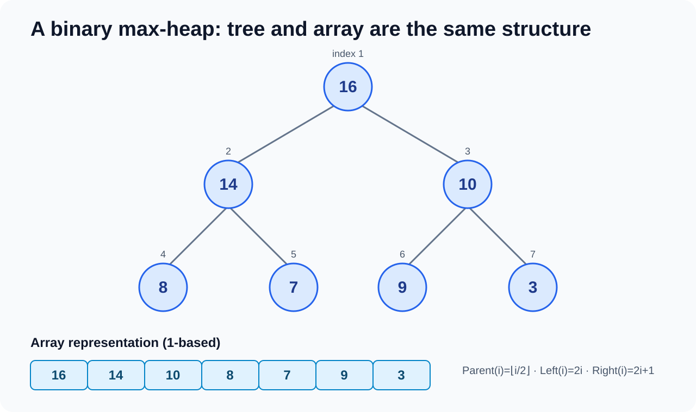

# Chapter 6 — Heapsort

**Reference:** CLRS, *Introduction to Algorithms*, Fourth Edition (2022), Chapter 6.  
**Scope:** Binary heaps, maintaining the heap property, building a heap, heapsort, and priority queues.

These are original study notes aligned to the chapter. Array indices in the textbook are 1-based; Python implementations later in the repository will use 0-based indexing and explain the translation.

## Learning objectives

- Model a heap as a nearly complete binary tree stored in an array.
- Distinguish max-heaps from min-heaps and state the heap-size invariant.
- Derive parent and child indices and the heap-height bound.
- Prove and analyze MAX-HEAPIFY.
- Explain why bottom-up BUILD-MAX-HEAP is \(\Theta(n)\), not merely \(O(n\lg n)\).
- Prove HEAPSORT correct and establish its \(\Theta(n\lg n)\) worst-case time and \(O(1)\) auxiliary space.
- Implement max- and min-priority-queue operations and understand object-to-index handles.
- Use heaps for d-ary queues and k-way merging; understand Young tableaux.

---

## 6.1 Heaps

A binary heap is an array object that represents a nearly complete binary tree. Every level is full except possibly the last, which is filled from left to right. Each tree node corresponds to one array element.

The array \(A[1:n]\) has an attribute \(A.heap\text{-}size\), with
\[
0\le A.heap\text{-}size\le n.
\]
Only \(A[1:A.heap\text{-}size]\) belongs to the heap. The remaining array suffix may contain values already placed in final sorted positions.

For Python's 0-based list indexing, the corresponding formulas are \(\operatorname{parent}(i)=\lfloor(i-1)/2\rfloor\), \(\operatorname{left}(i)=2i+1\), and \(\operatorname{right}(i)=2i+2\).

### Index calculations

For the textbook's 1-based indexing:
\[
PARENT(i)=\lfloor i/2\rfloor,\quad LEFT(i)=2i,\quad RIGHT(i)=2i+1.
\]

A max-heap satisfies
\[
A[PARENT(i)]\ge A[i]
\]
for every nonroot node. Thus its maximum is at the root. A min-heap reverses the inequality and stores its minimum at the root.

The heap property is local: it constrains each node against its parent or children. It does **not** say that the array is globally sorted.

### Height

A heap of height \(h\) has at least \(2^h\) nodes along the completely filled levels through depth \(h-1\), and at most \(2^{h+1}-1\) nodes. Consequently an \(n\)-element heap has
\[
h=\lfloor\lg n\rfloor.
\]
The height is \(\Theta(\lg n)\). A node at height \(h\) can be involved in a downward repair of at most \(h\) levels.

The leaves are exactly the indices
\[
\lfloor n/2\rfloor+1,\ldots,n.
\]
This follows because any index greater than \(\lfloor n/2\rfloor\) has no left child.

**Where can values occur?** The smallest value in a max-heap must occur at a leaf. With distinct keys, the \(k\)-th largest value must be at depth at most \(k-1\), because a node has at most \(k-1\) ancestors; the root is the largest.

---

## 6.2 Maintaining the heap property

### MAX-HEAPIFY

Precondition: the subtrees rooted at LEFT(i) and RIGHT(i) are max-heaps; only the value at \(i\) may violate the max-heap property.

    MAX-HEAPIFY(A, i)
        l = LEFT(i)
        r = RIGHT(i)
        largest = i
        if l <= A.heap_size and A[l] > A[largest]
            largest = l
        if r <= A.heap_size and A[r] > A[largest]
            largest = r
        if largest != i
            exchange A[i] with A[largest]
            MAX-HEAPIFY(A, largest)

At each step, the largest of the node and its existing children moves to the parent position. If a child is promoted, the displaced value may violate the heap property only in that child's subtree, so the algorithm recurses there. The procedure terminates when the current node is at least as large as both children or is a leaf.

**Correctness argument:** The two child subtrees start as heaps. Choosing the largest of the parent and children makes the parent satisfy the heap property. The only possible remaining violation is at the child that received the old parent value. Recursing repairs exactly that subtree. At termination the entire subtree rooted at the original \(i\) is a max-heap.

At most one root-to-leaf path is followed. Since the heap height is \(O(\lg n)\), the running time is \(O(\lg n)\); more precisely it is \(O(h)\) for a node of height \(h\). A worst-case input can force a swap at every level, so the bound is tight: \(\Theta(\lg n)\).

For any node, each child subtree has at most \(2n/3\) nodes. The worst shape has a full left subtree and a right subtree that is one level shorter; this yields the recurrence
\[
T(n)\le T(2n/3)+\Theta(1)=O(\lg n).
\]
The exact largest constant fraction is \(2/3\) (as a supremum, attained up to rounding for suitable complete-tree sizes).

### MIN-HEAPIFY

Use the same structure, but select the smallest of the node and its children and swap if a child is smaller. Its running time is also \(O(\lg n)\).

### Iterative form

Recursion can be replaced with a loop: repeatedly find the largest among \(i\), its left child, and its right child; stop if \(i\) is largest; otherwise swap and set \(i\) to the child index. This uses \(O(1)\) auxiliary space and avoids recursive-call overhead.

---

## 6.3 Building a heap

    BUILD-MAX-HEAP(A, n)
        A.heap_size = n
        for i = floor(n/2) downto 1
            MAX-HEAPIFY(A, i)

All leaves already are one-element heaps. Process internal nodes in decreasing index order. When processing node \(i\), both children have larger indices and have already been converted into heaps. MAX-HEAPIFY therefore has its required precondition.

**Loop invariant:** At the start of each iteration, every node with index greater than \(i\) is the root of a max-heap. Initialization holds because all those nodes are leaves. Maintenance follows because the children of \(i\) are already heaps, and MAX-HEAPIFY makes the subtree rooted at \(i\) a heap. At termination, node 1 is a max-heap root, so the whole array is a max-heap.

### Why BUILD-MAX-HEAP is linear

The loose argument “\(n\) calls, each \(O(\lg n)\)” gives \(O(n\lg n)\), but ignores that most nodes are near the leaves.

There are at most \(\lceil n/2^{h+1}\rceil\) nodes of height \(h\), and MAX-HEAPIFY on a node of height \(h\) costs \(O(h)\). Therefore
\[
T(n)\le \sum_{h=0}^{\lfloor\lg n\rfloor}
\left\lceil\frac{n}{2^{h+1}}\right\rceil O(h)
=O\left(n\sum_{h\ge0}\frac{h}{2^h}\right)=O(n),
\]
because \(\sum_{h\ge0}h/2^h=2\). Since every array element must be considered, building a heap is also \(\Omega(n)\). Thus
\[
\boxed{T(n)=\Theta(n)}.
\]

BUILD-MIN-HEAP is identical except that it calls MIN-HEAPIFY.

---

## 6.4 The heapsort algorithm

    HEAPSORT(A, n)
        BUILD-MAX-HEAP(A, n)
        for i = n downto 2
            exchange A[1] with A[i]
            A.heap_size = A.heap_size - 1
            MAX-HEAPIFY(A, 1)

The maximum is at the root. Swapping it with the final heap element places it in its final sorted position. Decreasing heap_size excludes that position from subsequent heap operations. MAX-HEAPIFY restores the heap on the remaining prefix.

### Correctness: loop invariant

At the start of each iteration with loop index \(i\):
- \(A[1:i]\) is a max-heap containing the \(i\) smallest elements of the original array.
- \(A[i+1:n]\) contains the \(n-i\) largest elements, in sorted order.
- Every element in the heap prefix is no larger than every element in the sorted suffix.

Initialization: BUILD-MAX-HEAP establishes the heap property and the sorted suffix is empty.

Maintenance: the root is the maximum of the heap prefix, hence the largest element not yet placed. Swapping it with \(A[i]\) puts it immediately before the existing sorted suffix in correct order. Shrinking the heap excludes that element. MAX-HEAPIFY restores the max-heap property on the remaining prefix.

Termination: when \(i=1\), the one remaining heap element is the smallest. Together with the sorted suffix, the entire array is sorted.

BUILD-MAX-HEAP costs \(\Theta(n)\). The loop performs \(n-1\) MAX-HEAPIFY calls, each \(O(\lg n)\), giving \(O(n\lg n)\). The worst-case bound is tight, so heapsort takes \(\Theta(n\lg n)\) time. It is in-place with \(O(1)\) auxiliary storage, but it is not stable.

Already increasing or decreasing input still takes \(\Theta(n\lg n)\) worst-case time asymptotically: heap construction is linear and the repeated extraction/repair phase has logarithmic-height operations. The exact number of swaps/comparisons can differ by input order.

---

## 6.5 Priority queues

A priority queue stores objects with keys. A max-priority queue supports:

| Operation | Meaning | Heap implementation |
|---|---|---:|
| MAXIMUM | Return object with largest key | \(\Theta(1)\) |
| EXTRACT-MAX | Remove and return largest-key object | \(O(\lg n)\) |
| INCREASE-KEY | Raise an object's key | \(O(\lg n)\) |
| INSERT | Add an object | \(O(\lg n)\) |

A min-priority queue supports MINIMUM, EXTRACT-MIN, DECREASE-KEY, and INSERT, using a min-heap.

### Max-priority queue pseudocode

    MAX-HEAP-MAXIMUM(A)
        if A.heap_size < 1: error "heap underflow"
        return A[1]

    MAX-HEAP-EXTRACT-MAX(A)
        if A.heap_size < 1: error "heap underflow"
        maximum = A[1]
        A[1] = A[A.heap_size]
        A.heap_size -= 1
        if A.heap_size > 0
            MAX-HEAPIFY(A, 1)
        return maximum

    MAX-HEAP-INCREASE-KEY(A, i, key)
        if key < A[i].key: error "new key is smaller"
        A[i].key = key
        while i > 1 and A[PARENT(i)].key < A[i].key
            exchange A[i] with A[PARENT(i)]
            i = PARENT(i)

    MAX-HEAP-INSERT(A, x)
        if A.heap_size == A.capacity: error "heap overflow"
        A.heap_size += 1
        key = x.key
        x.key = -infinity
        A[A.heap_size] = x
        MAX-HEAP-INCREASE-KEY(A, A.heap_size, key)

INCREASE-KEY moves the raised key upward because only the parent relationship can now be violated. MAX-HEAPIFY is the wrong direction for this repair: it moves a value downward and assumes the child subtrees are already heaps.

The temporary \(-\infty\) in insertion ensures that the new leaf is a valid max-heap element before the increase-key operation. A handle or mapping from application objects to heap indices is needed when operations name an object rather than an array position. Every swap must update that mapping. Hash tables can provide expected \(O(1)\) object-to-index lookup, but worst-case lookup may be \(\Theta(n)\).

### Engineering patterns

- Use a max-priority queue for scheduling the highest-priority job.
- Use a min-priority queue for discrete-event simulation, always processing the next event time.
- A FIFO queue can be simulated by assigning increasing timestamps and extracting the smallest timestamp; a stack can use decreasing timestamps or a reversed priority convention.
- K-way merging uses a min-heap containing the current smallest unconsumed element from each nonempty list. Each of \(n\) outputs costs \(O(\lg k)\), for \(O(n\lg k)\) total time.

---

## d-ary heaps

A d-ary heap has up to \(d\) children per node. With 1-based indexing, the children of \(i\) occupy indices \(d(i-1)+2\) through \(d(i-1)+d+1\), and the parent of \(i>1\) is \(\lfloor(i-2)/d\rfloor+1\).

Its height is \(\Theta(\log_d n)\). Extract-max examines up to \(d\) children at each level, costing \(O(d\log_d n)\). Increase-key and insertion travel only upward, costing \(O(\log_d n)\).

---

## Young tableaux

An \(m\times n\) Young tableau has rows and columns sorted in nondecreasing order. Empty cells are represented by \(+\infty\) (the textbook uses an infinity symbol). A tableau is empty if its top-left cell is infinity and full if its bottom-right cell is finite.

- EXTRACT-MIN: remove the top-left minimum, put infinity there, and repeatedly move the smaller of the right and lower neighbors into the vacancy. This takes \(O(m+n)\).
- INSERT: place a new value in the bottom-right empty cell and repeatedly swap it with the larger of its upper and left neighbors while it violates the row/column order. This takes \(O(m+n)\).
- SEARCH: start at the top-right. If the target is smaller, move left; if larger, move down. Each move eliminates a row or column, so \(O(m+n)\).
- Sorting \(n^2\) values: build an \(n\times n\) tableau, then perform \(n^2\) extract-min operations. The total is \(O(n^3)\).

---

## Common mistakes

1. Confusing the allocated array length with heap_size.
2. Applying MAX-HEAPIFY when its child subtrees are not already heaps.
3. Claiming BUILD-MAX-HEAP is \(O(n\lg n)\) as its tight bound.
4. Forgetting to shrink the heap after placing the maximum in heapsort.
5. Calling heapsort stable (it is not).
6. Using MAX-HEAPIFY to repair an increased key.
7. Ignoring object-to-index mapping costs in a real priority queue.
8. Forgetting that d-ary extract-max must inspect up to \(d\) children per level.

## Chapter notes

The chapter attributes heapsort to Williams and the bottom-up heap construction procedure to Floyd. It notes later improvements and alternative priority-queue structures, including Fibonacci heaps, strict Fibonacci heaps, van Emde Boas trees, and integer-priority-queue results. The key practical distinction is that heapsort has strong worst-case and space guarantees, while other structures can improve particular priority-queue operations.

## Coverage audit

- [x] Section 6.1: heap representation, max/min property, height, index arithmetic
- [x] Section 6.2: MAX-HEAPIFY, correctness, recurrence, iterative form
- [x] Section 6.3: BUILD-MAX-HEAP loop invariant and linear-time proof
- [x] Section 6.4: HEAPSORT, correctness, complexity and in-place property
- [x] Section 6.5: priority-queue operations, handles, applications
- [x] d-ary heaps and Young tableaux
- [x] Exercises 6.1-1 through 6.5-11 — companion file
- [x] Problems 6-1 through 6-3 — companion file

**Status:** Chapter 6 notes drafted; companion solutions and three-way audit remain before completion.
