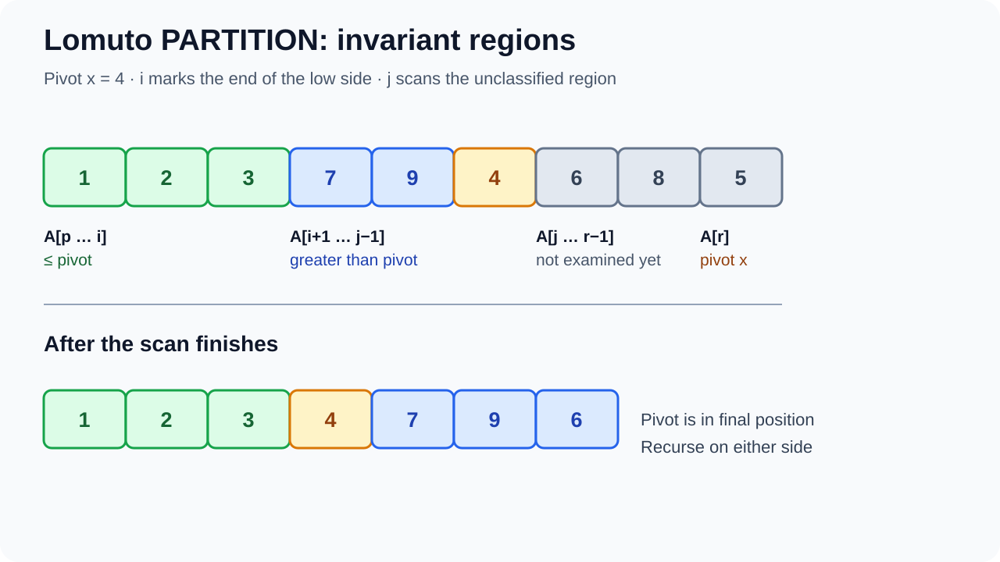

# Chapter 7 — Quicksort

**Reference:** CLRS, *Introduction to Algorithms*, Fourth Edition (2022), Chapter 7, printed pages 183–198.  
**Companion:** [Exercises and Problems](Exercises-and-Problems.md)

Quicksort is an in-place divide-and-conquer sorting algorithm. Unlike merge sort, it does its work before recursion: partitioning places a pivot into its final position, then recursive calls sort the two sides. The partition step is linear, but the split sizes determine recursion depth and running time.

## Learning objectives

- Explain the divide, conquer, and combine steps of quicksort.
- State and prove the PARTITION loop invariant.
- Analyze best-, worst-, and constant-proportion splits.
- Explain why deterministic pivot selection can be sensitive to input order.
- Implement randomized pivot selection and randomized quicksort.
- Derive the expected \(O(n\lg n)\) comparison bound using indicator random variables.
- Understand equal-key handling, Hoare partitioning, tail-recursion elimination, and pivot strategies.

## 7.1 Description of quicksort

For a subarray \(A[p:r]\), partitioning rearranges values into a low side, a pivot, and a high side. If the pivot finishes at index \(q\), every value in \(A[p:q-1]\) is at most \(A[q]\), and every value in \(A[q+1:r]\) is at least the pivot. Quicksort recursively sorts the two sides. No merge is needed.

    QUICKSORT(A, p, r)
        if p < r
            q = PARTITION(A, p, r)
            QUICKSORT(A, p, q - 1)
            QUICKSORT(A, q + 1, r)

The initial call in the textbook is QUICKSORT(A, 1, n). Python uses 0-based indices.

### PARTITION

The textbook selects the final element \(x=A[r]\) as pivot. Index \(i\) marks the end of the low side. The loop scans each element before the pivot.

    PARTITION(A, p, r)
        x = A[r]
        i = p - 1
        for j = p to r - 1
            if A[j] <= x
                i = i + 1
                exchange A[i] with A[j]
        exchange A[i + 1] with A[r]
        return i + 1

**Loop invariant, at the start of each iteration:**
1. \(A[p:i]\) contains values at most \(x\).
2. \(A[i+1:j-1]\) contains values greater than \(x\).
3. \(A[r]=x\).
4. \(A[j:r-1]\) has not yet been classified.

Initialization: \(i=p-1\) and \(j=p\), so the first two regions are empty. The pivot remains at \(r\).

Maintenance: if \(A[j]>x\), advance \(j\); the value joins the high region. If \(A[j]\le x\), advance \(i\), exchange \(A[i]\) and \(A[j]\), and advance \(j\). The new value at \(i\) belongs to the low region, and the displaced high-region value joins the high region.

Termination: the loop performs exactly \(r-p\) iterations. At the end, the unclassified region is empty. Exchanging \(A[i+1]\) with the pivot places \(x\) between the two regions. The returned \(q=i+1\) is the pivot's final index.

The pivot is strictly less than every element on its high side because all values moved there were greater than the pivot. Values equal to the pivot may appear on the low side.

### Cost

The loop examines \(r-p\) elements, so PARTITION takes \(\Theta(r-p+1)=\Theta(n)\) time on a subarray of \(n\) elements. It uses \(O(1)\) auxiliary storage.

## 7.2 Performance of quicksort

Let \(q\) be the pivot's final index relative to the subarray. The recursive subproblem sizes are \(q\) and \(n-q-1\), and partitioning costs \(\Theta(n)\).

### Worst-case partitioning

The most unbalanced split has sizes 0 and \(n-1\):
\[
T(n)=T(n-1)+T(0)+\Theta(n)=T(n-1)+\Theta(n).
\]
Summing partition costs gives
\[
\Theta(n+(n-1)+\cdots+1)=\boxed{\Theta(n^2)}.
\]
With the last-element pivot, already sorted or reverse-sorted inputs can trigger this behavior, depending on ordering and distinct keys. Recursion depth is \(\Theta(n)\), so the call stack can also use \(\Theta(n)\) space.

### Best-case partitioning

The most balanced split has two subproblems of size at most \(n/2\):
\[
T(n)=2T(n/2)+\Theta(n)=\boxed{\Theta(n\lg n)}.
\]
The recursion depth is \(\Theta(\lg n)\).

### Constant-proportion splits

Suppose every split has sizes \(\alpha n\) and \(\beta n\), where \(\alpha+\beta=1\) and both constants are positive. The shortest and longest root-to-leaf paths have lengths approximately \(\log_{1/\alpha}n\) and \(\log_{1/\beta}n\). Each level costs \(O(n)\), so the total is \(O(n\lg n)\).

Even a 9-to-1 or 99-to-1 split has logarithmic depth when the proportions remain constant. Balance need not mean an exact half-and-half split.

### Average-case intuition

Assume all permutations of distinct input keys are equally likely. Some pivots create good splits and others bad splits. A bad split followed by a good split can be charged to a good split of comparable total cost; occasional poor splits need not make the entire recursion quadratic. Exercise 7.2-6 quantifies the probability of obtaining a split at least as balanced as a fixed constant ratio.

Quicksort's in-place partitioning refers to array storage, not stack usage. Stack depth depends on recursion depth.

## 7.3 A randomized version of quicksort

Instead of always using \(A[r]\) as the pivot, choose an index uniformly from \(p,\ldots,r\), exchange that element with \(A[r]\), and run PARTITION.

    RANDOMIZED-PARTITION(A, p, r)
        i = RANDOM(p, r)
        exchange A[r] with A[i]
        return PARTITION(A, p, r)

    RANDOMIZED-QUICKSORT(A, p, r)
        if p < r
            q = RANDOMIZED-PARTITION(A, p, r)
            RANDOMIZED-QUICKSORT(A, p, q - 1)
            RANDOMIZED-QUICKSORT(A, q + 1, r)

Randomization makes pivot rank uniformly distributed regardless of original input order. It does not remove the quadratic worst case for every random outcome; it gives an expected \(O(n\lg n)\) running time for distinct keys.

## 7.4 Analysis of quicksort

### 7.4.1 Worst-case analysis

For a partition producing sides of sizes \(q\) and \(n-1-q\):
\[
T(n)=\max_{0\le q\le n-1}\{T(q)+T(n-1-q)\}+\Theta(n).
\]
Using the substitution guess \(T(n)\le cn^2\), the sum of squared subproblem sizes is maximized at an extreme split:
\[
q^2+(n-1-q)^2\le(n-1)^2.
\]
For sufficiently large \(c\), the linear partition term is absorbed by the difference between \(cn^2\) and \(c(n-1)^2\). This proves \(O(n^2)\). The maximally unbalanced recurrence gives \(\Omega(n^2)\), so the worst-case bound is \(\Theta(n^2)\).

### 7.4.2 Expected running time: count comparisons

Let the distinct keys in sorted order be \(z_1<z_2<\cdots<z_n\). Let \(X\) be the total number of key comparisons made by PARTITION.

**Lemma 7.1:** The running time is \(O(n+X)\). There are at most \(n\) partition calls because each call fixes one pivot permanently; the non-comparison overhead per call is constant, and the loop comparisons account for \(X\).

**Lemma 7.2:** A pair \(z_i,z_j\) with \(i<j\) is compared if and only if one of them is the first pivot chosen from \(Z_{ij}=\{z_i,\ldots,z_j\}\). If the first pivot from this set lies strictly between the two keys, they are separated into different recursive subproblems and never compared. A pair is compared at most once.

**Lemma 7.3:** Since each of the \(j-i+1\) keys in \(Z_{ij}\) is equally likely to be the first pivot chosen from that set,
\[
\Pr\{z_i\text{ compared with }z_j\}=\frac{2}{j-i+1}.
\]

Define indicator \(X_{ij}=1\) if \(z_i,z_j\) are compared, and 0 otherwise. By linearity of expectation,
\[
\begin{aligned}
E[X]
&=\sum_{i=1}^{n-1}\sum_{j=i+1}^{n}E[X_{ij}]\\
&=\sum_{i=1}^{n-1}\sum_{j=i+1}^{n}\frac{2}{j-i+1}\\
&=O(n\lg n),
\end{aligned}
\]
using the harmonic-series bound. Lemma 7.1 then gives \(E[T(n)]=O(n\lg n)\). Combined with the \(\Omega(n\lg n)\) best-case lower bound, the expected running time is \(\Theta(n\lg n)\) for distinct keys.

### Important qualifications

- The expected-time theorem assumes distinct key values.
- Randomized quicksort still has a \(\Theta(n^2)\) worst-case execution for unlucky pivot choices.
- Duplicate-heavy inputs need a partitioning scheme that handles equal keys efficiently; see Problem 7-2.
- The expected comparison bound is derived by summing pairwise comparison probabilities, not by assuming every partition is balanced.

## Practical engineering considerations

### Tail-recursion elimination

The second recursive call can be replaced by updating the bounds and iterating. This removes one recursive call per partition, but a naive implementation can still have \(\Theta(n)\) stack depth if it always recurses on the larger side.

A stronger approach recursively sorts the smaller side and iterates over the larger side. This bounds stack depth by \(O(\lg n)\), because each recursive call is on at most half of the current elements.

### Three-way partitioning for duplicates

A Dutch-national-flag partition maintains three regions: less than pivot, equal to pivot, and greater than pivot. Recursive calls skip the entire equal region. This avoids repeatedly recursing through a large block of identical values.

### Pivot selection

Random pivot selection protects expected performance against fixed input order. Median-of-three selection samples three elements and uses their median as pivot; it changes constants and split probabilities, not the \(\Theta(n\lg n)\) expected asymptotic order.

### Comparison with other sorts

| Algorithm | Best | Average / expected | Worst | Auxiliary space |
|---|---:|---:|---:|---:|
| Insertion sort | \(\Theta(n)\) | \(\Theta(n^2)\) | \(\Theta(n^2)\) | \(O(1)\) |
| Merge sort | \(\Theta(n\lg n)\) | \(\Theta(n\lg n)\) | \(\Theta(n\lg n)\) | \(O(n)\) |
| Heapsort | \(\Theta(n\lg n)\) | \(\Theta(n\lg n)\) | \(\Theta(n\lg n)\) | \(O(1)\) |
| Randomized quicksort | \(\Theta(n\lg n)\) | \(\Theta(n\lg n)\) expected | \(\Theta(n^2)\) | Expected \(O(\lg n)\), worst \(O(n)\) naive recursion |

## Common mistakes

1. Forgetting that PARTITION returns the pivot's final index.
2. Recursing on a range that includes the pivot.
3. Claiming that in-place quicksort uses \(O(1)\) total auxiliary space; the recursion stack is additional.
4. Treating a randomized algorithm's expected bound as a guarantee for every run.
5. Using the distinct-key comparison probability without stating its assumption.
6. Assuming a balanced split must be exactly 50:50.
7. Ignoring duplicate-key behavior.
8. Replacing both recursive calls with an unbounded loop/recursion combination without analyzing stack depth.

## Chapter notes

The chapter credits quicksort to C. A. R. Hoare. The textbook's PARTITION procedure is attributed to N. Lomuto by Bentley; Hoare's original partition appears in Problem 7-1. The chapter also points to implementation engineering, killer adversaries, and the importance of practical details in partitioning.

## Coverage audit

- [x] 7.1 Description, PARTITION, loop invariant and correctness
- [x] 7.2 Worst, best, balanced and average-case intuition; stack depth
- [x] 7.3 Randomized pivot selection
- [x] 7.4 Worst-case substitution proof and expected comparison analysis
- [x] Exercises 7.1-1 through 7.4-6 — companion file
- [x] Problems 7-1 through 7-7 — companion file
- [x] Python implementations and tests — companion files

**Status:** Chapter 7 notes drafted. Companion solutions, tests, and final source/chat/GitHub audit remain.
