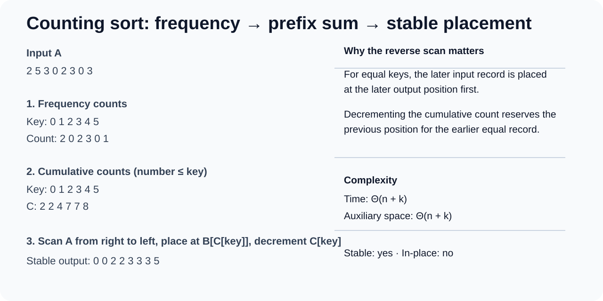

# Chapter 8 — Sorting in Linear Time

**Reference:** CLRS, *Introduction to Algorithms*, Fourth Edition (2022), Chapter 8, printed pages 205–226.  
**Companion:** [Exercises and Problems](Exercises-and-Problems.md)

Comparison sorting has a worst-case lower bound of \(\Omega(n\lg n)\). Counting sort, radix sort, and bucket sort can beat that bound on inputs with additional structure because they use key values, digit positions, or distribution assumptions rather than relying only on comparisons.

## Learning objectives

- Model comparison sorts with decision trees and prove the \(\Omega(n\lg n)\) lower bound.
- Implement stable counting sort and explain its cumulative-count array.
- Explain why radix sort processes least-significant digits first and requires a stable intermediate sort.
- Derive radix-sort time bounds in terms of digit width.
- Implement bucket sort and derive its expected linear running time under uniform independent inputs.
- Recognize when assumptions fail and how they affect performance.

---

## 8.1 Lower bounds for sorting

A comparison sort learns relative order only through comparisons between input elements. Assume distinct keys: this is sufficient for a lower bound because an algorithm that handles arbitrary inputs must also handle distinct ones.

### Decision-tree model

For a fixed input size, represent the comparisons of a comparison sort by a full binary tree:
- Each internal node is a comparison between two original input positions, such as \(a_i\le a_j\).
- The two outgoing edges represent the two possible outcomes.
- Each reachable leaf represents a permutation of the input positions in sorted order.

A correct sorting algorithm must be able to produce all \(n!\) permutations, so its decision tree has at least \(n!\) reachable leaves.

### Theorem 8.1 — Comparison-sorting lower bound

If the tree has height \(h\), it has at most \(2^h\) leaves. Therefore
\[
n!\le 2^h
\quad\Longrightarrow\quad
h\ge\lg(n!)=\Omega(n\lg n).
\]
Thus every comparison sort requires \(\Omega(n\lg n)\) comparisons in the worst case.

### Corollary 8.2

Heapsort and merge sort are asymptotically optimal comparison sorts: their worst-case \(O(n\lg n)\) upper bounds match the lower bound.

The lower bound does not apply to algorithms that inspect key values and use them as array indices. Counting sort, radix sort, and bucket sort exploit this distinction.

---

## 8.2 Counting sort

Counting sort assumes each input key is an integer in \([0,k]\). It counts occurrences, converts counts to cumulative positions, and places records directly into output positions. Its running time is \(\Theta(n+k)\), and it is stable.

### Pseudocode

    COUNTING-SORT(A, n, k)
        let B[1:n] and C[0:k] be new arrays
        for i = 0 to k
            C[i] = 0
        for j = 1 to n
            C[A[j]] = C[A[j]] + 1
        for i = 1 to k
            C[i] = C[i] + C[i - 1]
        for j = n downto 1
            B[C[A[j]]] = A[j]
            C[A[j]] = C[A[j]] - 1
        return B

### Meaning of the count array

After the frequency-counting pass, \(C[i]\) is the number of input elements equal to \(i\). After the cumulative pass,
\[
C[i]=|\{j:A[j]\le i\}|.
\]
So \(C[A[j]]\) is the final position of the current occurrence of key \(A[j]\), before decrementing the count to reserve the preceding position for an earlier equal key.

### Why the reverse traversal is stable

The output loop processes input from right to left. For equal keys, the later input occurrence is placed at the later output position first; the count is then decremented, so the earlier occurrence is placed immediately before it. Their original relative order is preserved.

### Complexity and properties

- Initialize \(C\): \(\Theta(k)\).
- Count input frequencies: \(\Theta(n)\).
- Compute prefix sums: \(\Theta(k)\).
- Place output records: \(\Theta(n)\).
- Total: \(\Theta(n+k)\) time and \(\Theta(n+k)\) auxiliary space.
- Stable; not in-place in the textbook version.
- If \(k=O(n)\), time is \(\Theta(n)\).

Counting sort is useful as a stable subroutine for radix sort.

---

## 8.3 Radix sort

Radix sort processes keys digit by digit, starting with the least significant digit. After each pass, it uses a stable sort on the current digit. Stability preserves the ordering established by all less significant digits.

    RADIX-SORT(A, n, d)
        for i = 1 to d
            use a stable sort to sort A on digit i

For a date key, for example, stable passes sort first by day, then month, then year. The final ordering is lexicographic by the full key.

### Correctness by induction

After pass 1, the array is sorted by the least significant digit. Assume after pass \(i-1\) it is sorted by the \(i-1\) least significant digits. Pass \(i\) orders by digit \(i\); stability preserves the previous ordering among records whose current digit is equal. Therefore after pass \(i\), the array is sorted by its \(i\) least significant digits. After \(d\) passes, the entire key is sorted.

### Time with d digits and k possible values per digit

If the stable digit sort takes \(\Theta(n+k)\), then \(d\) passes take
\[
\boxed{\Theta(d(n+k))}.
\]
For constant \(d\) and \(k=O(n)\), this is linear.

### Bit-width tradeoff

For \(n\) \(b\)-bit integers, group bits into digits of \(r\) bits. There are \(\lceil b/r\rceil\) passes and \(2^r\) possible digit values, giving
\[
\Theta\left(\frac br(n+2^r)\right)
\]
up to the ceiling on the number of passes.

If \(b<\lg n\), choosing \(r=b\) gives \(\Theta(n)\). If \(b\ge\lg n\), choosing \(r\approx\lg n\) gives \(\Theta(bn/\lg n)\) within a constant factor.

The asymptotic bound alone does not determine the fastest practical sort. Cache behavior, memory use, pass overhead, and implementation constants matter. Counting-sort-based radix sort is not in-place.

---

## 8.4 Bucket sort

Bucket sort assumes \(n\) independent values drawn uniformly from \([0,1)\). It distributes each value into one of \(n\) equal-width buckets, sorts each bucket with insertion sort, and concatenates the buckets.

    BUCKET-SORT(A, n)
        create buckets B[0:n-1], initially empty
        for i = 1 to n
            insert A[i] into B[floor(n * A[i])]
        for i = 0 to n - 1
            sort B[i] with insertion sort
        concatenate buckets in order
        return result

Correctness: if \(x\le y\), then \(\lfloor nx\rfloor\le\lfloor ny\rfloor\). Thus \(x\) is either in an earlier bucket than \(y\), or in the same bucket where insertion sort orders them.

### Expected-time analysis

Let \(n_i\) be the number of elements in bucket \(i\). All work except the per-bucket insertion sorts is \(O(n)\). Since insertion sort takes quadratic time on a bucket of size \(n_i\),
\[
T(n)=\Theta(n)+\sum_{i=0}^{n-1}O(n_i^2).
\]

For each bucket, \(n_i\) is binomial with \(n\) trials and success probability \(1/n\). Hence
\[
E[n_i]=1,\quad \operatorname{Var}(n_i)=1-\frac1n,
\]
and
\[
E[n_i^2]=\operatorname{Var}(n_i)+E[n_i]^2=2-\frac1n.
\]
By linearity of expectation,
\[
E[T(n)]=\Theta(n)+n\cdot O(2-1/n)=\boxed{\Theta(n)}.
\]

If all elements fall into one bucket, insertion sort takes \(\Theta(n^2)\), so the worst-case time is quadratic. More generally, bucket sort is linear whenever the sum of squared bucket sizes is \(O(n)\), even if the input is not uniform.

---

## Engineering guide: choosing a linear-time sort

| Input structure | Suitable algorithm | Main condition |
|---|---|---|
| Integers in a small bounded range | Counting sort | \(k=O(n)\) |
| Fixed-width integer or multi-field keys | Radix sort | Stable digit sort; manageable digit range |
| Values spread uniformly over \([0,1)\) | Bucket sort | Expected bucket occupancy remains small |
| Arbitrary comparable keys | Merge sort / heapsort / quicksort | No key-domain assumptions |

## Common mistakes

1. Applying the comparison-sorting lower bound to counting or radix sort.
2. Forgetting that a decision tree needs at least \(n!\) reachable leaves.
3. Omitting the cumulative-sum pass in counting sort.
4. Traversing input left-to-right in the textbook counting-sort placement loop and thereby losing stability.
5. Sorting radix digits from most significant to least significant without a different proof.
6. Using an unstable digit sort in radix sort.
7. Claiming bucket sort is worst-case linear.
8. Forgetting the distribution assumption behind bucket sort's expected bound.

## Chapter notes

The chapter credits Ford and Johnson with the decision-tree model; Seward with counting sort and combining it with radix sort; the least-significant-digit card-sorting method is described as a longstanding practical technique. Bucket sort's basic idea is credited to Isaac and Singleton. It also discusses theoretical integer-sorting improvements and columnsort (Problem 8-7).

## Coverage audit

- [x] 8.1 Decision trees and comparison-sorting lower bound
- [x] 8.2 Counting sort, stability, and \(\Theta(n+k)\) analysis
- [x] 8.3 LSD radix sort, induction proof, bit-width tradeoff
- [x] 8.4 Bucket sort, distribution assumption, expected-time derivation
- [x] Exercises 8.1-1 through 8.4-6 — companion file
- [x] Problems 8-1 through 8-7 — companion file
- [x] Python implementations and tests — companion files

**Status:** Chapter 8 notes drafted. Companion solutions, tests, and final source/chat/GitHub audit remain.
